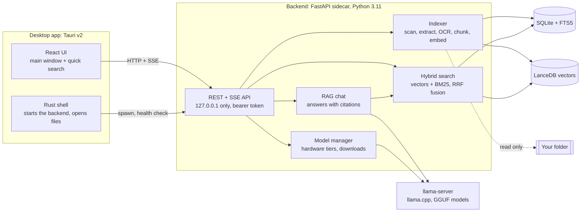
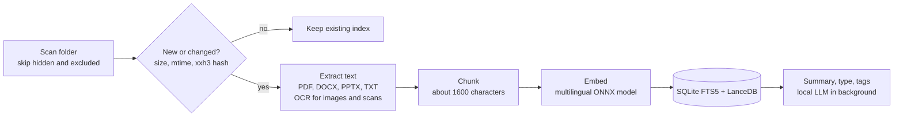

<div align="center">

# Smart Space

**A local-first, privacy-focused AI file manager.**<br/>
Search your files by meaning and chat with them. Everything runs on your own computer.


</div>

Pick one folder. Smart Space reads every document, image and scanned page in it, understands German and English,
and lets you ask questions like *"How much is my rent?"*. The answer cites the exact file it came from.
No cloud, no account, no telemetry: the app only goes online when you download a model.

> Software engineering capstone project, built from the *SMART SPACE Technical Specification (SDD) v0.1*.

## Features

- **Search by meaning and by keyword.** "rental contract" finds a German *Mietvertrag*, while exact terms like
  `INV-20417` still match. Results come back in 50–200 ms.
- **Chat with your files.** Answers use only your documents, with numbered citations, follow-up questions,
  and German or English replies.
- **Reads almost anything.** PDF, Word, PowerPoint, text, Markdown, CSV, plus photos and scanned PDFs through OCR.
- **Summaries and tags.** Every file gets a short summary, a document type (invoice, contract, CV, lecture, …) and tags.
- **Stays in sync.** A folder watcher picks up new, changed, renamed and deleted files within seconds.
- **Fits your hardware.** It checks CPU, RAM and GPU, places the machine in one of five tiers, and recommends
  models that run well on it.
- **Privacy dashboard.** See everything the app stored, delete any part of it, and export your summaries.

## Privacy by design

- The backend listens only on `127.0.0.1` and every request needs a per-session token.
- The only outbound traffic is a model download you start: HTTPS from allowlisted Hugging Face hosts,
  checked against a SHA-256 hash before use.
- Your files are opened read-only and are never modified, moved or deleted. A test runs every purge mode and
  verifies the folder byte for byte afterwards.
- Logs contain no file contents and no search queries. There is no telemetry.

## Status

| Part | Owner | Status |
|---|---|---|
| Backend: FastAPI sidecar with indexing, search, chat, models and privacy | Developer B | ✅ Working prototype, 88 automated tests |
| Desktop app: Tauri v2 + React (main window, quick-search window) | Developer A | 🚧 In progress |
| Packaging | Both | ✅ Backend builds and runs as a PyInstaller sidecar · 🚧 Tauri installer |

## Example

Answers produced by the backend on the demo folder (Qwen2.5 3B running locally):

> **You:** How much is my monthly rent and when did the lease start?<br/>
> **Smart Space:** Your monthly rent is 950 Euro. The lease started on March 1, 2024. **[1]**<br/>
> <sub>[1] Housing/Mietvertrag_2024.pdf</sub>
>
> **You:** And how high is the deposit?<br/>
> **Smart Space:** The security deposit is 2,850 Euro, divided into three installments. **[1]**
>
> **You:** Wie hoch war meine Steuererstattung 2023?<br/>
> **Smart Space:** Die Steuererstattung für 2023 betrug 1.240 Euro. **[1]**
>
> **You:** What is the capital of Australia?<br/>
> **Smart Space:** I could not find it in the indexed files.

| Search query | Top result | How it matched |
|---|---|---|
| `rental contract` | `Housing/Mietvertrag_2024.pdf` | Meaning, across languages |
| `Haftpflichtversicherung` | `Scans/Scanned_Insurance_Letter.pdf` | OCR of a scanned page |
| `how much was the cappuccino` | `Images/receipt_coffee.png` | OCR of a photo |
| `INV-20417` | `Finance/Invoice_Laptop_2024.pdf` | Exact keyword |

## How it works



**Indexing.** Every file goes through the same pipeline. Search works as soon as a file is embedded;
summaries follow in the background.



**Search** runs a vector search (meaning) and a BM25 keyword search side by side. It merges both rankings with
Reciprocal Rank Fusion and boosts files whose names match. **Chat** retrieves the best passages the same way,
numbers them, and asks the local model to answer only from those passages and cite them as `[1]`, `[2]`.

## Tech stack

| Area | Technology |
|---|---|
| Desktop shell | Tauri v2 (Rust) |
| UI | React 18, TypeScript, Vite, Tailwind CSS |
| Backend | FastAPI, Uvicorn, Pydantic v2, Server-Sent Events |
| Language model runtime | llama.cpp `llama-server` (CUDA, Vulkan or CPU) with GGUF models |
| Embeddings | fastembed (ONNX Runtime), multilingual MiniLM or E5 |
| OCR | RapidOCR (ONNX) |
| Vector store | LanceDB |
| Metadata and keyword search | SQLite with FTS5 |
| Document parsing | PyMuPDF, python-docx, python-pptx, charset-normalizer |
| File watching, hashing | watchdog, xxHash |
| Packaging | PyInstaller (backend sidecar), Tauri bundler |

## Models and hardware tiers

The app checks your hardware and recommends one model per role. You can pick any model; one that is too big for
your tier gets a warning.

| Tier | Hardware | Recommended models |
|---|---|---|
| 0 | Less than 8 GB RAM, or no AVX2 | MiniLM + Qwen2.5 1.5B (summaries off) |
| 1 | 8–15 GB RAM, no usable GPU | MiniLM + Qwen2.5 3B on CPU |
| 2 | 16 GB RAM and a 4–5 GB GPU | MiniLM + Qwen2.5 3B on GPU |
| 3 | 6–11 GB GPU, or 24 GB+ RAM | MiniLM or E5 Large + Qwen2.5 7B |
| 4 | 12 GB+ GPU | E5 Large + Qwen2.5 14B |

| Model | Role | Download |
|---|---|---|
| Multilingual MiniLM-L12 v2 (`emb-mini`) | Embeddings | 252 MB |
| Multilingual E5 Large (`emb-large`) | Embeddings | 2.25 GB |
| RapidOCR PP-OCR | OCR | bundled |
| Qwen2.5 Instruct 1.5B / 3B / 7B / 14B, Q4_K_M | Language model | 1.1 / 2.1 / 4.7 / 9.0 GB |

All models are listed in a data-only catalog ([`backend/app/models_catalog.json`](backend/app/models_catalog.json)),
so you can swap in a newer model without changing code.

## Getting started

The desktop app is still in progress. Until it lands, you run and try the backend on its own.

**You need:** Windows 10 or 11, [uv](https://docs.astral.sh/uv/), and about 3 GB of free disk space for the
smallest model set. A GPU is optional.

```powershell
git clone https://github.com/AnasMehfooz/Smart-Space.git
cd Smart-Space

# Python 3.11 environment with pinned dependencies
uv --directory backend sync --python 3.11

# llama.cpp server, pinned build, SHA-256 verified (goes to backend\bin\llama)
powershell -ExecutionPolicy Bypass -File scripts\fetch_llama_server.ps1

# Optional: demo folder with German and English documents, photos and a scanned PDF
powershell -ExecutionPolicy Bypass -File scripts\make_demo_workspace.ps1

# Start the backend at http://127.0.0.1:8765 with token "dev"
powershell -ExecutionPolicy Bypass -File scripts\dev_backend.ps1
```

Open **http://127.0.0.1:8765/docs**, click **Authorize**, enter `dev`, and try the endpoints. From Git Bash, the
whole flow looks like this:

```bash
H="Authorization: Bearer dev"; B=http://127.0.0.1:8765/api/v1; J="Content-Type: application/json"
curl -X POST -H "$H" $B/models/emb-mini/download             # 252 MB, activates itself when done
curl -X POST -H "$H" $B/models/llm-3b/download               # 2.1 GB
curl -X PUT  -H "$H" -H "$J" -d '{"root_path":"C:/path/to/Smart-Space/demo_workspace"}' $B/workspace
curl -X POST -H "$H" $B/index/start
curl -H "$H" $B/index/status
curl -X POST -H "$H" -H "$J" -d '{"query":"rental contract"}' $B/search
curl -X POST -H "$H" -H "$J" -d '{}' $B/chat/sessions         # returns {"id": 1, ...}
curl -N -X POST -H "$H" -H "$J" -d '{"content":"How much is my rent?"}' $B/chat/sessions/1/messages
```

## Results

Measured on the development laptop (Intel i5-12450H, 16 GB RAM, NVIDIA RTX 5060 Ti 16 GB):

| Measure | Result |
|---|---|
| Hybrid search | 50–200 ms per query |
| Indexing the demo folder (17 files, 4 needing OCR) | about 35–40 s |
| Chat with Qwen2.5 3B on the GPU | about 83 tokens/s, first answer about 3 s |
| Summaries | about 2 s per file |
| Search quality (32 German and English test queries) | correct file in the top 3: 97%, in the top 10: 100% |
| Automated tests | 88 passing, about 2 minutes, fully offline |
| Packaged backend (PyInstaller) | starts in about 4 s |

## Testing

```powershell
cd backend
uv run --python 3.11 pytest -q
```

The tests run offline with a small test embedder and a stand-in language model server. They cover the chunker,
search ranking, hardware tiers, GPU memory planning, path safety, every file extractor, the API contract,
resumable downloads, the purge safety guarantee, and a full end-to-end run: index, search, summaries, chat with
citations, folder watching, model switching, purge and re-index.

## Documentation

- [docs/API.md](docs/API.md): API guide for the frontend (onboarding flow, endpoints, live event streams)
- [docs/openapi.json](docs/openapi.json): machine-readable API contract
  (`npx openapi-typescript docs/openapi.json -o src/lib/api-types.ts`)
- [backend/README.md](backend/README.md): backend setup, configuration, packaging and design decisions

## Repository structure

```
Smart-Space/
├── backend/                 FastAPI sidecar (Python 3.11)
│   ├── app/                 API routes, services, schemas, prompts, model catalog
│   ├── tests/               pytest suite, demo data generator, stand-in LLM, search eval
│   ├── pyproject.toml       dependencies (exact versions in uv.lock)
│   └── smartspace-backend.spec   PyInstaller build
├── docs/                    API guide and OpenAPI contract
├── scripts/                 dev server, llama.cpp download, demo data, backend build
└── apps/desktop/            Tauri + React app (coming)
```

## Roadmap

- [x] Backend: indexing, OCR, hybrid search, chat with citations, model manager, privacy controls
- [x] Backend packaged as a standalone sidecar
- [ ] Desktop app: onboarding, home, search, chat, privacy and settings pages
- [ ] Spotlight-style quick-search window on a global shortcut
- [ ] Windows installer that bundles the backend
- [ ] Test on a low-end machine (CPU only, 8 GB RAM)
- [ ] Shrink the packaged backend (1.1 GB today)
- [ ] Optional: reranker for high-end machines, Tesseract OCR fallback

## Team

Two-person team: **Developer A** builds the frontend and the desktop shell, **Developer B** builds the AI and
backend.

## License

No license has been chosen yet. Notes on third-party components:

- llama.cpp, FastAPI and Tauri are MIT licensed; LanceDB, fastembed and RapidOCR use Apache-2.0.
- PyMuPDF is AGPL-3.0. That is fine for academic use; swap it for pypdf if the project needs a permissive license.
- Qwen2.5 1.5B, 7B and 14B are Apache-2.0. Qwen2.5 3B uses the Qwen Research License (non-commercial).
- MiniLM is Apache-2.0 and E5 is MIT.
